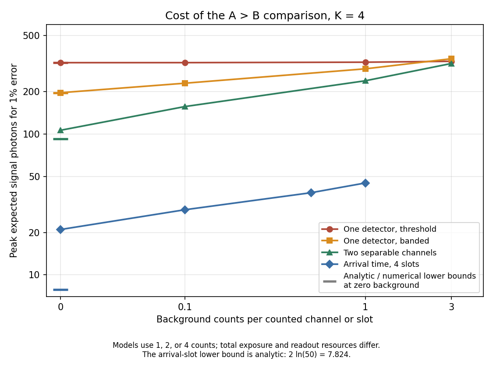
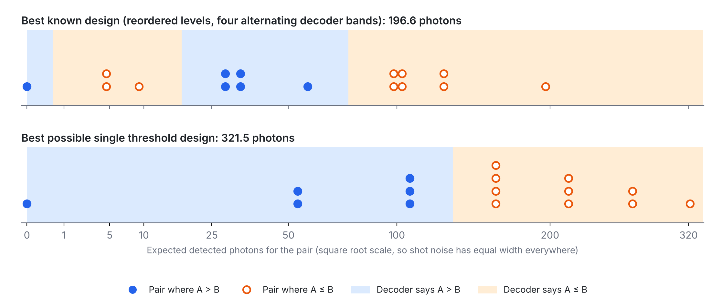
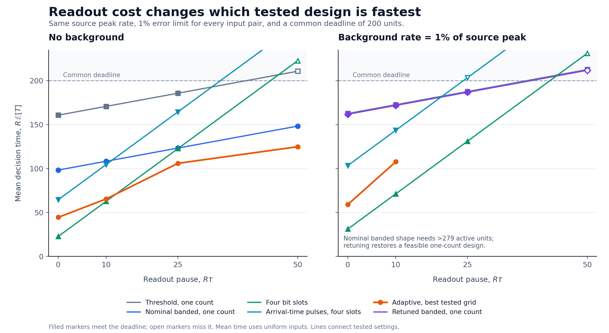

# What it costs to compare two numbers with light

Two independently encoded light sources each hold a number from 0 to 3. A photon-counting receiver must decide whether A > B, with at most 1% error for every input pair. This repository studies several observation resources and their costs in expected detected signal photons. It also compares selected designs under a common source-rate limit, readout pause and deadline.

| Observation resource | Photons at 1% error, no background | Lower bound at zero background | Photons at beta = 1 |
| --- | --- | --- | --- |
| One summed count, single threshold | 321.5 | 321.5366, numerical certificate | 324.0 |
| One summed count, reordered banded levels | 196.6 | 195.53, numerical certificate | 290.7 |
| Two separately counted channels | 106.4 | 92.29, analytic chain evaluated numerically | 239.1 |
| Four arrival-time slots, one detector | 21.0 | 7.824, analytic zero-count bound | 44.9 |

Here beta is expected background **per observed window, channel or slot**. Consequently beta = 1 gives one, two or four expected total background counts across the respective observations. This ladder is not a comparison at a common physical background rate; the resource experiment below supplies that comparison. The nonzero-background two-channel and arrival-time rows rescale fixed shapes, while the one-count shapes were searched separately at each background.

Within the **one-count, four-level model**, reordering brightness levels saves about **38.85%** against the optimal single-threshold scheme. The 196.62 construction and recorded 195.53 numerical lower bound bracket the optimum within about **0.6%**. These bounds use floating-point tables and solver tolerances. Separating channels or resolving arrival-time slots changes the observation resource and permits smaller signal budgets. The 20.97-photon arrival-time construction does not by itself establish shorter latency or lower electrical energy.

The zero-background headline assumes ideal detection and sources that switch fully off. Background reduces the one-count advantage, and this peeled-band family loses to the threshold benchmark by K = 6. The repository also records a joint-argmax search and input-leakage calculations, with their scope stated below.

Run `./reproduce.sh quick` to check 39 headline numbers in about four minutes.

## The problem

Two transmitters hold integers A and B in {0..K-1}. Each independently maps its input to a deterministic nonnegative expected signal count, x[A] or y[B], integrated over one observation window. A single photon counter sees N, a Poisson count with mean x[A] + y[B] + background. The receiver may use any randomized function of N to decide whether A > B (ties count as false). The worst case error over all K squared pairs must be at most 1%. The cost P = max(x) + max(y) is the largest **expected detected signal-photon count** over input pairs; background photons are excluded from this signal budget, and P is not a hard bound on a realized count. The headline case is K = 4, where the optimal threshold scheme needs about 321.54 photons and a "peeled band" design needs about 196.62, against a recorded numerical lower bound of 195.53.

The original 201 photon candidate came from a ChatGPT conversation and was independently verified here (src/verify_candidate.py). Released under the MIT License (see LICENSE).

The [theory note](docs/theory.md) gives the threshold argument, pairwise lower-bound justification, and an analytic Gaussian optimum for every K. The [related-work note](docs/related_work.md) distinguishes this specific Poisson comparison from established function-oriented communication. Exact novelty remains unresolved.

## Continuation: photons, time, and actual feedback

The [research note](docs/research_note.md) connects the original result to two new reproducible experiments. Both retain explicit error constraints and distinguish numerical evidence from hardware measurements.

### A common clock changes the comparison

Each transmitter has peak detected signal rate R, every readout consumes a pause tau, and every design must finish by the same wall-clock deadline D. At zero background, with R*D = 200, the uniform-input mean times are:

| Readout pause R*tau | Fixed threshold | Fixed banded | Four bit slots | Four arrival slots | Adaptive banded, fastest tested grid |
| --- | ---: | ---: | ---: | ---: | ---: |
| 0 | 160.780 | 98.314 | **22.776** | 64.547 | 44.504 |
| 10 | 170.780 | 108.314 | **62.776** | 104.547 | 65.429 |
| 25 | 185.780 | 123.314 | 122.776 | 164.547 | **105.975** |
| 50 | misses deadline | 148.314 | misses deadline | misses deadline | **124.853** |

Times are multiplied by R. For illustration only, R = 1,000,000 detected signal counts/second makes the displayed numbers microseconds, with a 200-microsecond deadline. All accepted policies have at most 1% error for every input pair. The adaptive mean-time objective uses uniform inputs; hard cases can take the full deadline. Its mean advantage does not establish an advantage in worst-case latency.

The four-bit result uses the full comparator error allowance and needs 22.7756 peak expected signal photons. The refitted arrival-time design needs only 20.9696, but each equal slot must accommodate its stronger B pulse, so its active duration is 64.5468/R. Under uniform inputs, mean signal counts are 11.3878 for four bits and 20.8488 for arrival time: peak-photon and mean-photon objectives differ. The fixed banded/four-bit timing crossover is approximately R*tau = 25.18 for these two designs.

At background rate b/R = 0.01, a stored background-retuned banded shape needs 323.603 peak expected signal photons versus 325.372 for the fixed threshold shape; the unretuned shape is much worse. Four bits need 31.1869 and the refitted arrival-time shape 33.6289. These are selected encoding families, not globally optimal architectures. Sources and integration pause during readouts, and coordinated stopping is idealized with its cost charged to the readout parameters. Electrical energy is parameterized, not measured. See [methods and complete scope](docs/resource_methods.md) and [raw policies and results](results/resource_benchmark.json).

### Feedback with the receiver's own answers

A 32-state Markov calculation replaces the original correct-previous-answer side information with the receiver's actual previous decoded bit. At 1% spillover, the stored banded design changes from 0.999974% oracle error to 1.002228% stationary actual-feedback error. A tested 0.25% signal increase restores a fresh-start/all-subsequent-window numerical bound below 1% under IID uniform inputs. The repaired banded and threshold budgets are 320.134 and 326.205, respectively; these are tested feasible candidates, not optimized sequential budgets.

History remains consequential: an alternating bright/dark input sequence produces 9.226% maximum phase error for the original banded feedback design at 1% spillover. This does not contradict an IID-history-averaged guarantee. See [feedback methods](docs/feedback_methods.md) and [raw policies and results](results/feedback_sequence.json).

## Results

Status words: "verified" means numerically recomputed, including mpmath at 50 decimal digits for the original candidate. "Proved" refers to an analytic argument or reduction; numerical evaluations retain their tolerances. "Certified" means a lower bound from a solver dual bound, valid up to floating point in the h table and MILP tolerances, not an exact rational certificate. "Numerical upper bound" means a design whose error was checked by LP; it shows an achievable budget to the stated numerical accuracy, not global optimality.

| Result (K = 4 unless stated) | Value | Status |
| --- | --- | --- |
| 201 photon candidate, x=[100.5,4.7,0,29.4], y reversed, decoder "N==0 or 18<=N<=77": worst error | 0.959542% at (A,B)=(2,0), max mean 201 | verified (scipy and mpmath) |
| Same encoding with the best randomized (LP) decoder: worst error | 0.9178% | numerical |
| Same shape rescaled to 1% with the LP decoder | numerical boundary about 196.6943; 196.70 is a feasible rounded-up budget (196.69 gives 1.00007%, 196.70 gives 0.99991%) | numerical boundary for this fixed shape |
| Peeled band construction, numerical LP budget, K = 3,4,5,6,7,8 | 57.56, 196.62, 534.62, 1295.39, 2936.78, 6389.06 | numerical upper bound |
| Peeled band, pairwise budget 2 v_(K-1), K = 4 | 196.33 | arithmetic from h (not an achievable budget by itself) |
| Lower bound for ANY encoder and decoder, K = 3 | 57.43 | certified |
| Lower bound for ANY encoder and decoder, K = 4 | 195.53 | certified |
| Best single threshold decoder over all encoders, "low counts mean true" | 321.540 (corner u = 1.5, s = 107.18) | proved, lower bound certified to 321.5366 |
| Best single threshold decoder, "high counts mean true" | 452.319 | proved |
| Threshold search, K = 3 to 10 (low true) | 126.05, 321.54, 603.09, 971.21, 1425.53, 1966.96, 2594.72, 3308.93 | analytic reduction; grid/local search, adaptive numerical certificate run for K = 4 |
| Lower bound over monotone encoders (x nonincreasing, y nondecreasing), any decoder | 320.32 | certified |
| Lower bound for the average photon cost, any encoder and decoder | 65.50 | certified |
| Best average cost design found | 65.8 | numerical upper bound |
| Gaussian control (r = x[A] + y[B] + N(0,1)), all K >= 2 | 2(K-1)d with d = 2 Phi^-1(0.99) = 4.6527; attained by the threshold design | analytic proof in docs/theory.md; small-K MILP cross-checks |
| Gaussian control, peeled band chain K = 4 | 14d | arithmetic |
| Gain drift, shared gain within +-5%, best banded shape | 245.4 (monotone shapes: 598.2) | numerical upper bound |
| Error target 0.1%, 0.3%, 1%, 3%, 10%: banded vs threshold optimum | 354.7 vs 567.0, 262.3 vs 448.4, 196.5 vs 321.5, 137.0 vs 210.2, 74.8 vs 97.9 | numerical (banded); corner formula on a grid (threshold) |
| Drift plus background, banded vs monotone (bg 0.1 / 1 / 3 counts) | +-2%: 251.8 vs 405.1, 318.7 vs 406.5; +-5%: 288.8 vs 598.4, 366.7 vs 600.5, 435.4 vs 605.8 | numerical upper bound |
| Calibration every 10,000 decisions, +-5% drift (src/calibration.py) | saving 41.8% with no background, 15.1% at 1 count | model on interpolated numerical results |
| Margin d on K levels, 1 <= d <= K-1, equals A > B on K-d+1 levels; a nonconstant sum threshold A+B >= T has L = min(T+1, 2K-T) comparator levels (src/threshold_family.py) | margin 2 on K = 4 is the K = 3 comparator: 126.05 vs 57.56 | analytic reduction both ways, finite implementation checks K = 2 to 8; constant predicates cost zero |
| K = 3 comparator under background, threshold vs banded (bg 0 / 0.1 / 1 / 3 counts, src/background_k3.py) | 126.1 vs 57.6, 126.1 vs 70.5, 128.8 vs 94.5, 134.1 vs 115.4 (saving 54%, 44%, 27%, 14%) | numerical upper bound |

The remaining drift, background and error target runs are in results/ (raw JSON lines). results/bgdrift.jsonl designs can be rechecked with src/check_bgdrift.py. That check finds that a few designs are at up to 1.0009% error when the decoder fitted on a 41 point gain grid is tested at 401 gains, so those drift numbers are good to roughly a tenth of a percent in error, not exact. The values in the table above are the rescaled ones: the affected banded designs were scaled up 0.05% until the dense check passed at 1%.

Where the first round and this repo differ: the first round reported 196.75 for the 201 photon shape after LP rescaling. The numerical boundary is about 196.6943, and 196.70 is a feasible budget rounded up to two decimals; 196.75 came from a looser search and also passes. core.py was not changed to force a match.

## Privacy: what the count leaks

The banded design leaks more about each individual input conditional on the true comparison answer. Joint information beyond that answer is nearly unchanged, while total information about the pair is slightly lower. The photon saving therefore does not imply that the observation retains less task-irrelevant information. With independent uniform inputs and each design at its numerical 1% budget (src/leakage.py):

| Design | Leak beyond the answer, I(N; A,B \| answer) | Leak about A beyond the answer, I(N; A \| answer) | Best guess of A from the count |
| --- | --- | --- | --- |
| Threshold, 321.5 photons | 1.574 bits | 0.332 bits | 43.8% (same as from the answer alone) |
| Banded, 196.6 photons | 1.575 bits | 0.620 bits | 62.2% |

The threshold mean depends only on A minus B. The banded construction has more distinct mean levels, although some pairs still share a level. (A,B) = (2,1) is the unique zero-mean pair; observing zero photons does not identify it with certainty, because positive Poisson means can also produce a zero count. The table is computed directly from the count distributions. The originally reported 400,000-trial cross-check is not part of the committed reproduction suite.

## Molecular communication

The same question for receivers that count molecules (src/mc.py). Cost is max(x) + max(y), the worst expected current-message signal arrivals, excluding spillover. The error constraint is at most 1% for each current input pair, **averaged over an independent uniform previous input pair**. It is not a guarantee for every input history. Values are best found by search (2 or 3 starts) and rechecked, not proved, except the threshold row with no spillover.

| Spillover from the previous message | One type, threshold | One type, banded | Two types that cancel 1:1 | Two types counted separately |
| --- | --- | --- | --- | --- |
| 0 | 321.5 | 196.6 | 201.8 | 106.4 |
| 1% | 327.6 | 335.9 | not run | not run |
| 3% | 350.8 | none found | not run | not run |
| 10% | 720.8 | none found | 817.8 | 285.8 |

- For the same two independent accumulated counts, observing both is at least as informative as observing their difference. This toy subtraction model omits the reactions during propagation studied by Long et al. (2025), arXiv 2502.20484; it does not establish a performance ordering for their full physical system.
- Spillover is modeled as a fraction of a uniformly random, unknown previous message. "None found" means no searched design reached 1% below 20,000 molecules.
- The original FEEDBACK=answer experiment supplies the **correct previous comparison answer**; FEEDBACK=genie supplies the exact previous pair. These are side-information experiments. At 1% spillover the reported banded versus threshold budgets are 319.3 versus 326.2 with the correct answer, and 287.4 versus 325.5 with the exact pair. From 3% on the searched threshold designs win (results/mc_fb*.jsonl). Actual decoded-answer feedback is evaluated in the continuation below.
- Not modeled: reaction kinetics, nonlinear testbed responses, and spillover from more than one previous message.

## Two separable channels: an analytic lower bound

The two-type design (106.4) was found by search. src/twotype_bound.py adds a floor. Any two input pairs that differ in one coordinate and have opposite answers, such as (1,1) false and (2,1) true, force the receiver to tell Poisson(x[1]) from Poisson(x[2]) on one count alone, with both errors at most 1%. Chaining those Neyman-Pearson tests from zero gives minimum levels 0, 4.595, 19.94, 46.15 for each channel (the randomized test gives ln 99, not ln 100, for the first step), so the cost is at least 2 x 46.15 = 92.29 for any encoder and any decoder. The 106.4 design sits 15.2% above that floor; the floor is loose because it ignores that one decoder has to serve all 16 pairs at once.

## Arrival time

src/timecomp.py encodes each number as a time slot. A emits into slot A, B into slot B, and one detector counts each slot. The receiver must infer whether A's pulse occupies a later slot; ties put both pulses in one slot. Equal source pulse energies make (1,0) and (0,1) indistinguishable, so the stored design uses about 4.8 photons for A and 16.1 for B. At 1% error its peak expected signal budget is 20.97 photons (LP decoder, rechecked with mpmath), against 196.6 for the one-count banded design. It uses four resolved slots and an ideal timing reference.

The [analytic zero-count argument](docs/theory.md#7-a-valid-lower-bound-for-one-hot-arrival-time-pulses) gives a lower bound of 2*log(1/(2*epsilon)) = 7.824 photons for this one-hot pulse model at 1% error. The reported 9.11 from three pairwise Neyman-Pearson constraints is an **uncertified local-search value**, not a lower bound: minimizing a penalized relaxation from a finite set of Nelder-Mead starts does not establish its global minimum. It is retained as a diagnostic and excluded from certified-floor claims. With background, the stored fixed shape has feasible rescaled budgets 28.98, 38.29 and 44.91 at 0.1, 0.5 and 1 background count per slot; 3 counts per slot was not resolved. These are numerical upper bounds, not a global optimum over timing protocols.

## Price curve, sorting and argmax

src/price_curve.py prices one comparison as a function of the error target, for the banded, threshold and two-channel designs and the two-channel floor:

| Error target | Banded | Threshold | Two channels | Two-channel floor |
| --- | --- | --- | --- | --- |
| 0.1% | 346.5 | 567.0 | 174.6 | 154.2 |
| 1% | 196.6 | 321.5 | 106.4 | 92.3 |
| 10% | 94.0 | 97.9 | 49.7 | 33.0 |
| 30% | 37.1 | 16.2 | 19.2 | 8.1 |

These rows rescale specified shapes at each error target. A fitted power law is descriptive over the sampled range; it is not an asymptotic scaling theorem. The tested threshold shape is cheaper than the tested banded shape at the sampled 20% and 30% targets. The banded column differs from the separately optimized error-target runs in the results table above.

src/tournament.py estimates max-of-N and sorting costs using comparison error budgets whose sum is at most 1%. Equal allocation was best in the reported numerical allocation searches; no general allocation-optimality theorem is established. The interpolated estimates are 799 banded photons versus 413 on two channels for max of 4, 2,248 versus 1,141 for max of 8, and 1,494 versus 764 for a 5-comparison sorting tree on 4 items. These totals depend on interpolated comparison prices, so the union bound alone does not certify every interpolated operating point. Larger-N values extrapolate outside the computed error range and do not establish N (log N) squared asymptotic scaling.

src/argmax_joint.py searches for a direct encoding of three sources on one detector that identifies the largest input. For K = 3, the stored joint design costs 1,768 photons (multiclass LP decoder, rechecked with mpmath), against about 140.3 for two tested banded comparisons at 0.5% error each. The roughly 12.6-fold ratio compares these found designs. The structured-start Nelder-Mead search gives an upper bound on joint cost; it cannot rule out a substantially better joint encoding or prove that the gap is unavoidable. Pairwise decomposition is the cheaper demonstrated construction in this experiment.

## Quick start

    python3 -m pip install -r requirements.txt
    ./reproduce.sh quick        # 39 checks; prints each headline number next to its expected value, PASS or FAIL
    ./reproduce.sh extensions   # focused tests, Gaussian theorem, resource/feedback studies, and figure; outputs to results/rerun/extensions/
    ./reproduce.sh full         # lists the long jobs with their exact commands
    ./reproduce.sh full --run   # runs them one after another (hours); queue scripts write to results/rerun/

Run everything from the repo root. The scripts use nice -n 15 in reproduce.sh; set NICE="" to turn that off. The original environment was Python 3.13, numpy 2.5.3, scipy 1.18.1 (HiGHS), highspy 1.15.1, mpmath 1.4.1, matplotlib 3.11.2. The continuation results also record their actual runtime: Python 3.12.14, NumPy 2.3.5 and SciPy 1.17.0. They use the existing NumPy/SciPy/Matplotlib dependencies; no new dependency is required. Numerical solvers can choose different equally good policies across versions, so compare validated errors and objective values rather than policy bytes.

## What each script does

| File | What it does |
| --- | --- |
| src/core.py | Poisson LP decoder (worst case error), two point error e2, h(mu), budget for a shape. The error target is the EPS environment variable, default 0.01. |
| src/verify_candidate.py | Checks the 201 photon candidate: 16 pair errors with scipy and with mpmath at 50 digits, the LP decoder on the same encoding, and the rescaled budget. Seconds. |
| src/threshold_optimum.py | Best single randomized threshold decoder for any encoder: minimizes s*(u) g(u) over u, certifies it by adaptive bisection, cross checks with the LP. Argument "table" gives K = 3 to 10. About 10 s for K = 4, about 1 minute for the table. |
| src/banded.py | The peeled band construction for K = 2 to 8, checks the band rule for every pair, prints pairwise and exact LP budgets. Seconds. |
| src/gaussian_milp.py | Gaussian control solved as an exact MILP, plus the band chain cost. About 1 minute with K = 5. |
| src/gaussian_theorem.py | Attaining encoders and every conditional error for the analytic all-K Gaussian theorem. |
| src/resource_benchmark.py | Matched source-rate, background-rate and wall-deadline comparison, with a stopping-policy LP and independent per-pair propagation. |
| src/feedback_sequence.py | Actual decoded-answer feedback, startup/stationary probability propagation, tested repairs and specified adverse-history tests. |
| src/figure_resources.py | Resource-comparison figure from saved numerical results. |
| tests/ | 24 focused tests for the new proofs, per-pair constraints, probability propagation, timing and accounting. |
| src/make_hgrid.py | Regenerates data/hgrid.npy and data/hgrid_ext.npy from core.h and compares them with the shipped files. About 20 s. |
| src/lb_pairwise2.py | Certified lower bound through the pairwise relaxation as a MILP (needs h on a grid; HGRID, MONO, OBJ and USE_HIGHS environment variables select the variants). K = 3 takes about 1 minute, K = 4 takes tens of minutes per stage. |
| src/opt.py | Re-optimizes shapes under gain drift, background and average cost, with a robust LP decoder (Nelder Mead; environment variables BG and EXTRA). |
| src/check_bgdrift.py | Refits and retests the drift plus background designs. |
| src/leakage.py | Information the photon count leaks beyond the answer, per design. Seconds. |
| src/mc.py | Molecular receivers (one shared type, cancelling types, separately counted types), spillover (ISI) and decision feedback (FEEDBACK), with shape search. Environment variables ISI, FEEDBACK, EXTRA, NSTART. Minutes to an hour per run. |
| src/mc_check.py | Rechecks the stored best molecular and feedback designs. Seconds (quick) or minutes (all). |
| src/calibration.py | Cost of calibrating the gain with pilot pulses versus living with drift. Seconds. |
| src/figure_bands.py | Draws figures/fig_bands.png and .svg. |
| src/twotype_bound.py | Verifies the two-channel 106.4 design (2D LP, mpmath recheck) and computes the Neyman-Pearson chain floor 92.29. About 75 s. |
| src/price_curve.py | Cost of one comparison versus the error target for banded, threshold, two channels, and the two-channel floor. Seconds. |
| src/tournament.py | Max-of-N and sorting costs from priced comparisons under a union bound, plus the scaling fit. Seconds. |
| src/argmax_joint.py | Joint argmax of three sources on one detector, K = 3: multiclass LP decoder, verify of the stored design, --search reruns the ladder-start search (about 11 minutes). |
| src/timecomp.py | Arrival-time comparator with four slots: verifies the stored design; --beta rescales it for background; --bound reports the analytic zero-count floor and an uncertified pairwise-relaxation search. Seconds to a few minutes. |
| src/ladder_points.py, src/figure_ladder.py | Collects the ladder numbers into results/ladder.json (each with a source field) and draws figures/fig_ladder.png. The banded and threshold stray-light points come from queues/qLadder.sh runs of opt.py. |
| queues/*.sh | The exact command lists of the original long runs (drift, background, error targets, calibration). |
| data/ | h tables, row 0 is mu, row 1 is h(mu). |
| results/ | Raw JSON lines of every original run. |

Long job commands (also printed by ./reproduce.sh full):

    python3 src/lb_pairwise2.py 4 200 1500 8                                              # K=4 bound 195.53 (the 195.53 stage takes about 23 minutes, whole run is longer)
    USE_HIGHS=1 MONO=1 HGRID=data/hgrid_ext.npy python3 src/lb_pairwise2.py 4 330 1500 3  # monotone: 320.32
    USE_HIGHS=1 OBJ=avg HGRID=data/hgrid_ext.npy python3 src/lb_pairwise2.py 4 400 2400 2 # average: 65.50
    python3 src/opt.py free common 0.05 max 11 1 400                                      # banded under 5% drift: 245.4
    python3 src/opt.py monotone common 0.05 max 12 1 400                                  # monotone: 598.2
    python3 src/opt.py free nominal 0 avg 7 4 500                                         # average: 65.8

## How the lower bound works

Any scheme must separate every true pair mean m_t from every false pair mean m_f: restricting the decoder to those two hypotheses gives a two point test, so max(m_t, m_f) >= h(min(m_t, m_f)), where h(mu) is the smallest nu with two point minimax error 1% between Poisson(mu) and Poisson(nu). The MILP chooses, for each true and false pair, which one is higher, and uses a convex hull underestimator of the h staircase on each segment (h is increasing, so h on a table cell is at least its left value). The solver's dual bound is then a lower bound on P for every encoder and decoder.

## Limitations

- Analytic proofs and numerical models only. No hardware, no real detector, no dead time, afterpulsing or finite-bandwidth detector model. The resource extension uses a parameterized readout pause and ideal coordinated source gating.
- Floating point throughout. The "certified" numbers are solver dual bounds over a tabulated h (brentq at 1e-10, a 1e-6 margin and MILP tolerances), not exact rational certificates.
- The pairwise relaxation is a necessary condition. The gap between the 195.53 lower bound and the 196.62 design for K = 4 is not closed.
- Designs from opt.py come from Nelder Mead on a small number of starts. They are upper bounds only.
- The novelty search (is this construction or bound already known) is incomplete.
- The first round scripts that produced some numbers were lost and rewritten here. Every rewritten script reproduces the published numbers; the one difference (196.70 versus a looser 196.75) is explained above.
- The ladder chart is uneven between lines: the threshold and banded stray-light points re-optimize the shape per background, while the two-channel and arrival-time points rescale a fixed shape, so those two lines are upper bounds that a per-background search could lower.
- The two-channel lower bound is a necessary pairwise-testing condition, evaluated numerically. The arrival-time relaxation's 9.11 local-search result has no lower-bound certificate and establishes no optimality gap.
- The tournament and sorting totals use interpolated comparison prices. Their union-bound argument needs verified per-comparison error points; interpolation and larger-N extrapolation are estimates, not certified costs or asymptotic laws.
- The joint argmax search is Nelder-Mead from structured starts in nine dimensions; 1,768 is an upper bound on the joint optimum.
- The calibration model mixes worst case expected signal photons with amortized pilot photons and assumes constant gain between calibrations. The +/-3/sqrt(M) pilot interval is statistical; calibration failures are not allocated part of the 1% decision-error budget, so these percentages are illustrative accounting results rather than end-to-end equal-error guarantees.
